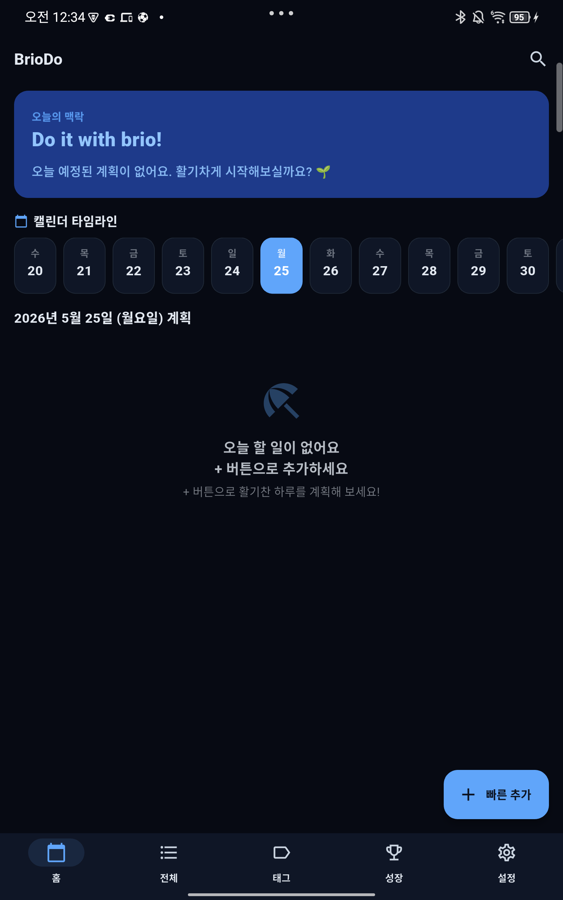
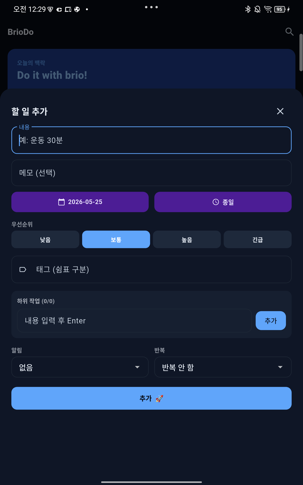
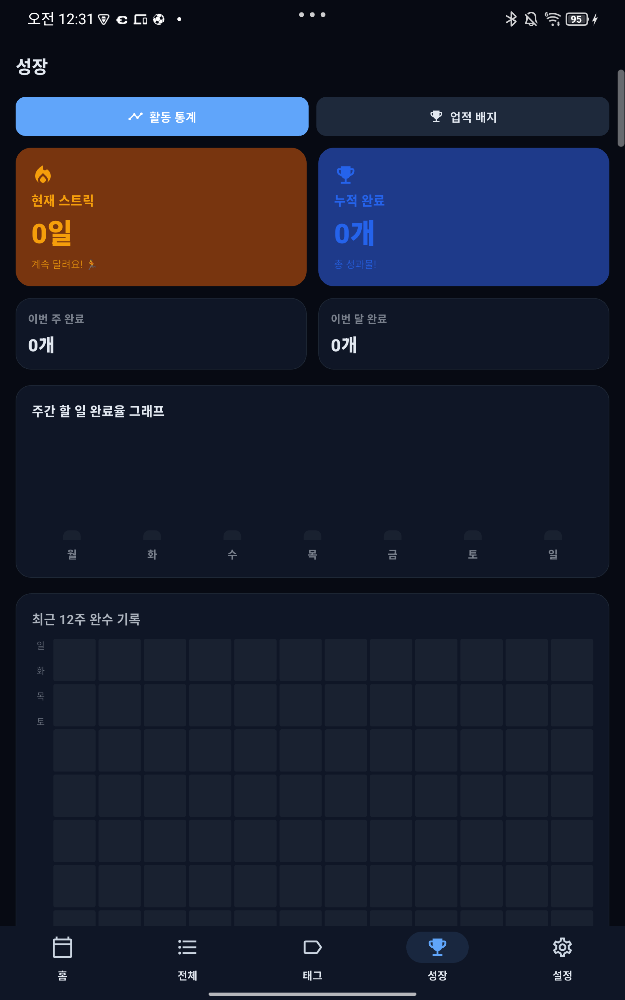

<div align="center">


# BrioDo

### 활기차게, 해내다. — Do it with brio.

**AI와 Google 캘린더가 손잡은, 가장 빠른 할 일 앱**

[](https://github.com/jeiel85/briodo-android/releases)
[](https://flutter.dev)
[](https://play.google.com/store/apps/details?id=app.briodo)
[](LICENSE)

[**홈페이지**](https://jeiel85.github.io/briodo-android/) · [**Google Play**](https://play.google.com/store/apps/details?id=app.briodo) · [**APK 다운로드**](https://github.com/jeiel85/briodo-android/releases/latest) · [**개인정보처리방침**](https://jeiel85.github.io/briodo-android/privacy-policy.html)

</div>

---

## BrioDo가 뭔가요

자연어 한 줄을 던지면 **Gemini AI**가 날짜·시간·우선순위·태그를 알아서 채워주는 할 일 앱입니다. 입력한 일정은 **Google 캘린더**와 양방향으로 동기화되고, 인터넷이 없어도 **오프라인 우선**으로 빠릿하게 동작합니다. 로그인 없이도 **게스트 모드**로 바로 사용할 수 있어요.

> *"내일 오전 10시 팀 미팅"* → BrioDo가 알아서 **2026-05-26 10:00 / 우선순위: 보통 / 태그: #업무** 로 만들어 줍니다.

## 주요 기능

| | |
|---|---|
| 🤖 **AI 자연어 입력** | Gemini 2.5 Flash가 한 줄 입력에서 날짜·태그·우선순위 추출 |
| 🎤 **음성 인식** | Android 네이티브 STT — 말로 던지면 할 일이 생성 |
| 📅 **Google 캘린더 양방향 동기화** | 전용 "BrioDo" 캘린더로 깔끔하게 분리 |
| 🌐 **오프라인 우선** | SQLite 로컬 캐시 → 온라인 복귀 시 자동 머지 |
| 🏆 **38개 업적 시스템** | 할 일을 완료할수록 브리오 포인트 적립 |
| 🔔 **알림 / 반복 일정** | 정각·10분 전·1시간 전 / 매일·매주·매월 |
| 📊 **통계 & 컬렉션 뷰** | 주간·월간·연간 완료율, 연속 달성일 추적 |
| 🏠 **홈 위젯 + 상태바 상주 알림** | 잠금화면에서도 오늘 할 일 한눈에 |
| 🌍 **4개 언어** | 한국어 / English / 日本語 / 中文 |
| 🎨 **테마 풀세트** | 다크 모드, 랜덤 테마, 폰트 / 색상 커스터마이징 |

## 스크린샷

<table>
  <tr>
    <td align="center"><br /><sub>홈 — 오늘</sub></td>
    <td align="center"><br /><sub>빠른 추가</sub></td>
    <td align="center"><br /><sub>성장 / 통계</sub></td>
  </tr>
</table>

## 다운로드

| 채널 | 링크 |
|---|---|
| **Google Play (권장)** | [play.google.com/store/apps/details?id=app.briodo](https://play.google.com/store/apps/details?id=app.briodo) |
| **APK (자동 업데이트 X)** | [GitHub Releases](https://github.com/jeiel85/briodo-android/releases/latest) |
| **APKPure** | (등록 진행 중) |
| **Samsung Galaxy Store** | (심사 대기) |

## 기술 스택

- **Flutter 3.x** + **Dart 3.11**
- **Riverpod 3** — 상태 관리
- **Firebase** — Auth · Firestore · Analytics
- **Google Calendar API** — 양방향 동기화
- **Gemini 2.5 Flash** — 자연어 → 구조화 데이터
- `flutter_local_notifications` · `home_widget` · `table_calendar` · `fl_chart`

## 빌드 및 실행

```bash
flutter pub get
flutter run                                 # 디버그
flutter build apk --release                 # APK (다이렉트 배포용)
flutter build appbundle --release           # AAB (Play Store용)
```

빌드 산출물: `build/app/outputs/flutter-apk/` · `build/app/outputs/bundle/release/`

> 🔑 Firebase / Google Sign-In / Gemini API 키는 별도 `.env` 와 `android/app/google-services.json` 이 필요합니다.

릴리스 서명은 저장소 루트 `keystore.properties`(git 제외, `.keystore/blenddo-release.jks`를 가리킴)에서 읽고, 환경 변수 `BRIODO_UPLOAD_STORE_FILE`·`BRIODO_UPLOAD_STORE_PASSWORD`·`BRIODO_UPLOAD_KEY_ALIAS`·`BRIODO_UPLOAD_KEY_PASSWORD`가 있으면 그쪽이 우선합니다(CI용). 둘 다 없으면 debug 키로 서명됩니다.

## 릴리스

Play 업로드는 GitHub Actions [`Play release`](.github/workflows/play-release.yml)가 맡습니다.

1. `pubspec.yaml`의 `version: x.y.z+N`을 올립니다(N = versionCode, Play에 올라간 적 없는 값).
2. 출시 노트를 `docs/release-notes/x.y.z/ko.txt`(필수)와 `en.txt`(선택)에 500자 이내로 적습니다.
3. main에 머지한 뒤 태그 `vx.y.z`를 push합니다(GitHub 릴리스를 만들면서 태그를 만들어도 같습니다).
4. 워크플로가 `play` 환경 승인을 기다립니다 — Actions 화면에서 jeiel85가 승인하면 시험 → AAB 빌드 → 업로드 인증서 SHA-256 확인 → **내부 테스트(internal)·비공개 테스트(alpha)** 에 올리고 트랙 상태를 출력합니다.
5. **프로덕션**은 태그로는 올라가지 않습니다. Actions에서 `Run workflow`로 같은 버전을 `production` 켜고 돌리면 이미 올라간 번들을 프로덕션에도 붙입니다(전체 출시). `dry_run`은 올리지 않고 빌드·서명·트랙 조회만 합니다.

- 비밀값(키스토어 base64·비밀번호·별칭·Play 서비스 계정 키)은 GitHub 환경 `play`의 Secrets에만 있습니다. 그 환경은 main 브랜치와 `v*` 태그에서만, 승인 후에만 돌아갑니다.
- 이 저장소의 다른 워크플로는 태그에 반응하지 않아 이중 실행이 없습니다. GitHub 릴리스(APK 첨부)는 지금처럼 손으로 만듭니다.
- **같은 버전을 로컬에서 Play에 올리지 않습니다**(전역 `play-publish` 스킬, Play Console 드래그 업로드 포함). 같은 versionCode는 Play가 두 번 받지 않으므로 먼저 올린 쪽만 성공하고 나머지는 실패합니다. 워크플로가 실패해 손으로 올려야 하면 그 버전의 워크플로 실행은 취소하거나 승인하지 않습니다.
- `docs/PLAY_UPLOAD_CHECKLIST.md`의 수동 업로드 절차(v1.3.0)는 이 워크플로 이전 기록입니다.

## 프로젝트 구조

```
lib/
├── main.dart
├── theme.dart
├── data/          # 로컬 DB (SQLite) · Firestore 어댑터
├── models/        # Task · Tag · Achievement · …
├── providers/     # Riverpod providers
├── screens/       # Today · Tasks · Collection · Settings
├── services/      # Gemini · Calendar · Notifications · HomeWidget
├── widgets/       # 재사용 UI
└── l10n/          # ko / en / ja / zh
```

## 라이선스

[MIT License](LICENSE) © 2026 [jeiel85](https://github.com/jeiel85)

## 문의 / 후원

- **이슈 / 제안** — [GitHub Issues](https://github.com/jeiel85/briodo-android/issues)
- **이메일** — jeiel85@gmail.com
- **후원** — [Ko-fi](https://ko-fi.com/) (앱 내 링크 제공)

---

<div align="center">
<sub>Made with 💜 in Korea · Do it with brio.</sub>
</div>
